# **FLASHDeconv & FLASHTnT User Guide**

Welcome to the **FLASHDeconv & FLASHTnT User Guide**. This guide provides a step-by-step walkthrough on using **FLASHDeconv** and **FLASHTnT**, from uploading data to processing and viewing results.

---

## **1️⃣ Uploading MS Data**

1. Navigate to **FLASHDeconv > Upload data** in the sidebar.
2. In the **"MS data"** tab, upload your `.mzML` files (one per run; Thermo `.raw` and Bruker `.d` are converted for you).
3. **Two options to add files:**
   - **Drag and Drop** your file into the upload box.
   - **Browse Files** to manually select the `.mzML` file.
4. Click **"Add MS Data"** to confirm the upload.

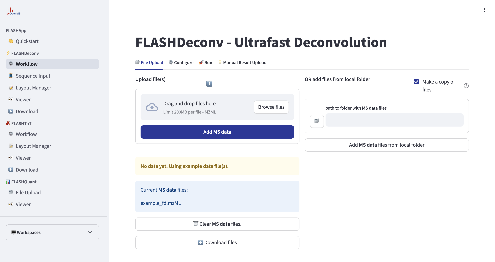

---

## **2️⃣ Configuring Parameters**

1. Navigate to **FLASHDeconv > Describe experiment**.
2. Select your uploaded **mzML files** (they appear in the file list).
3. In **1 · Samples and groups**, switch on **Compare the runs** to compare runs between conditions, and give each run its condition (see *Comparing runs* below).
4. Adjust **parameters** in **2 · Deconvolution**:
   - Set **threads** (recommended: 8).
   - Choose **General Settings** (e.g., `keep_empty_out`, `write_detail`).
   - Configure **FD settings** like `report_FDR`, `merging_method`, `min_mass`, `max_mass`, `min_charge`.
   - Adjust **SD settings** for deconvolution accuracy.
5. If you want to know more about each parameter go to this link: https://openms.de/FLASHDeconv

 
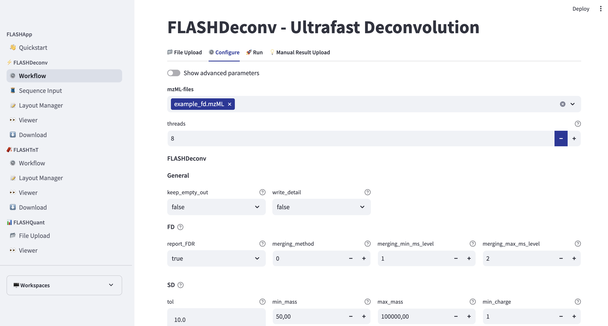

---

## **3️⃣ Running the Workflow**

1. Navigate to **FLASHDeconv > Run analysis**.
2. Set **log details** to `minimal` (or another level as needed).
3. Click **"Start Workflow"** to begin the deconvolution process.
4. Monitor the **log output** to track progress.

  
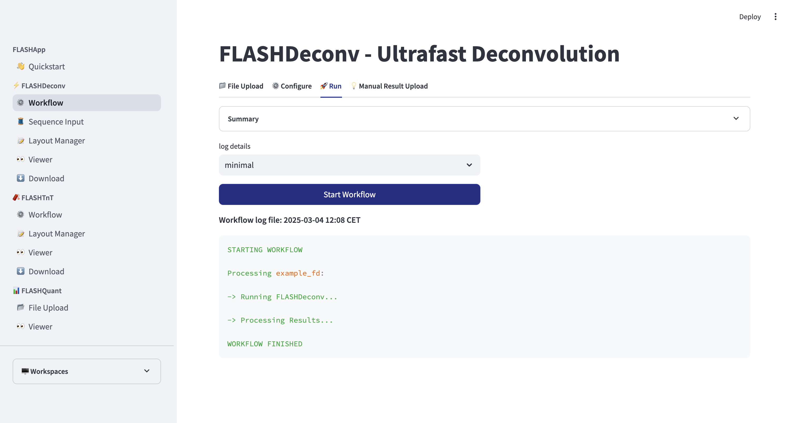

---

## **4️⃣ Viewing Results**

1. Once the workflow is finished, check the **log messages**.
2. Navigate to the **"Viewer"** tab in the sidebar to analyze the deconvoluted data.
3. If needed, **download results** by clicking **"Download Files"**.
   (Will be explained later in step 7 and 8 in this guide)

---

## **5️⃣ Manual Result Upload**

1. On **Upload data**, click the **"FLASHDeconv results"** tab.
2. Upload FLASHDeconv output files (`*_annotated.mzML` & `*_deconv.mzML`) or TSV files for ECDF Plot.
3. Browse files or **drag and drop** them into the upload section.
4. Click **"Add files to workspace"** to finalize.

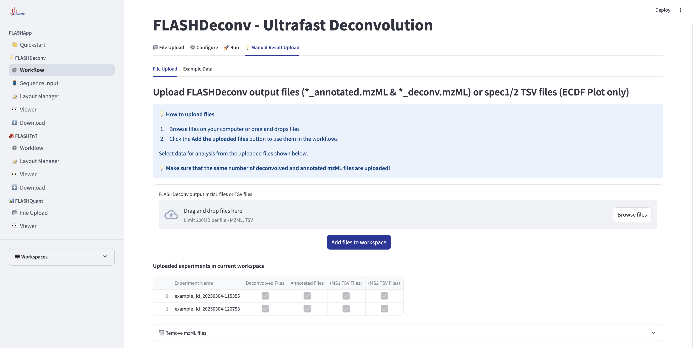

---

## **6️⃣ Using Example Data**

1. Click the **"Example Data"** tab.
2. Click **"Load Example Data"** to use the preloaded dataset.
3. The example data will appear in the uploaded experiments table.

 
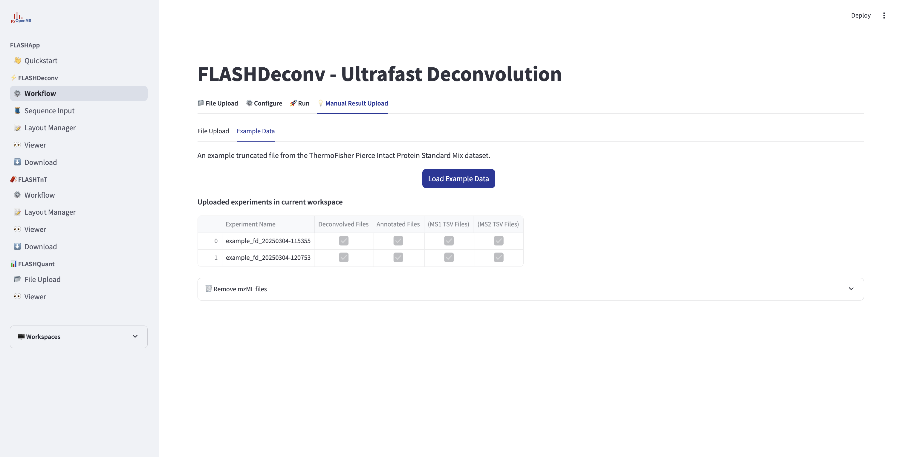

---

## **7️⃣ Layout Manager**

The **Layout Manager** allows users to customize the experiment display settings. Open it with **Edit layout** at the top of the **Viewer** page; it opens as a window over the Viewer.

1. Select the **number of experiments** to view at once.
2. Drag components from the list into the grid, or click one to add it. The list is grouped (Heatmaps, Tables, Spectra & plots, …); click a group to expand or collapse it, or type in the search field to filter by name (Enter adds the first match):
   - **MS1 raw heatmap** - 2D heatmap of raw MS signals with m/z (y-axis), retention time (x-axis), and intensity as color gradient.
   - **MS1 deconvolved heatmap** - Displays raw MS signals as a 2D heatmap with monoisotopic mass (y-axis), retention time (x-axis), and intensity as a color gradient.
   - **Scan table** - Lists scan details (e.g., number, retention time, precursor mass). 
   - **Deconvolved spectrum** - Plots deconvolved spectrum for a scan (summed intensity vs. monoisotopic mass).
   - **Raw spectrum** - Plots raw spectrum for a scan(intensity vs m/z).
   - **Mass table** - Display deconvolved masses for a selected scan with properties.
   - **3D S/N plot** - Visualizes S/N ratio of deconvolved masses in 3D.
   - **Isotope envelope fit** - The observed isotope envelope of the selected mass (all charges summed; the precursor of a fragmentation spectrum while no mass is selected) mirrored against the averagine envelope. A shifted apex points to a wrong monoisotopic mass.
   - **Precursor XIC by charge** - The precursor mass of the selected fragmentation spectrum traced over the MS1 spectra, one line per charge plus their sum.
   - **Run QC** - Optional (add it in the Layout Manager). Distributions over the whole run, per MS level: QScores, charge states and masses of the deconvolved masses, and the number of masses per spectrum over retention time. A failed acquisition or poor deconvolution shows here before the identifications are read.
3. Click **Save** to apply changes; the window closes and the Viewer shows the new layout.

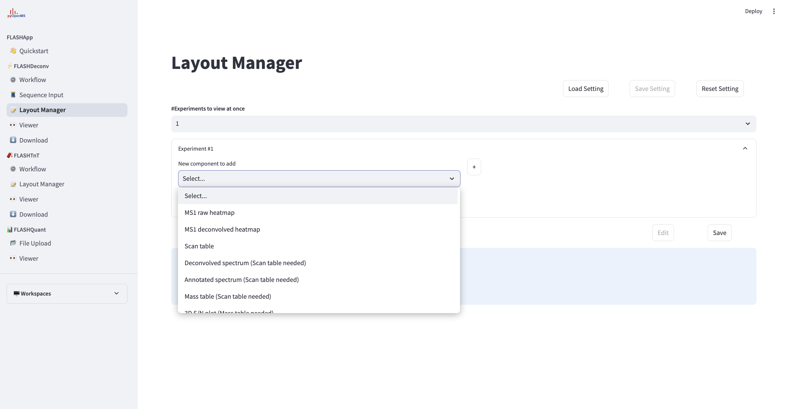

---

## **8️⃣ Viewing Results in FLASHViewer**

1. Navigate to the **Viewer** tab.
2. Choose an experiment from the dropdown.
3. View the selected one from Layout manager: scan table, mass table, annotated spectrum, and deconvolved spectrum etc.

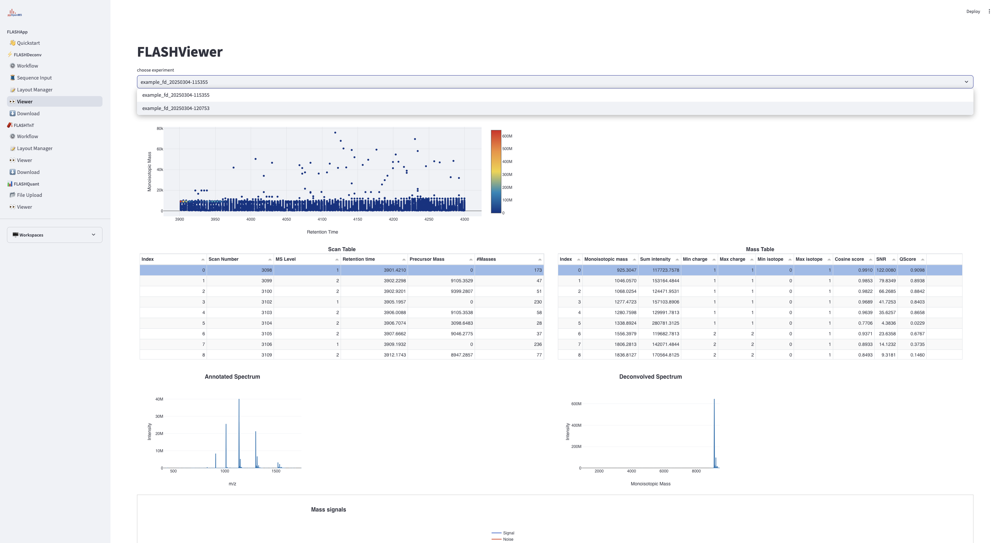

---

## **9️⃣ Downloading Results**

1. Navigate to the **Download** tab.
2. Locate the experiment you want to download.
3. Click **"Prepare Download"** to generate the downloadable files.
4. To delete an experiment, click the **trash icon** next to the experiment name.

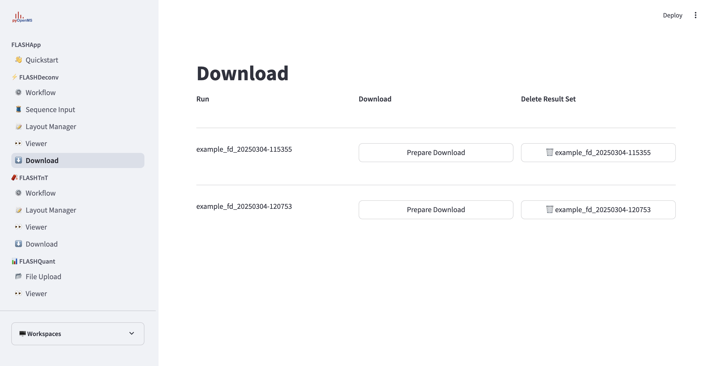

---

## **🔟 Comparing runs**

FLASHDeconv and FLASHTnT can compare runs measured under different conditions
(for example control and treated):

1. On **Describe experiment**, switch on **Compare the runs** in **1 · Samples and groups** and give
   each run its condition in the **Samples** table. At least three runs are needed, ideally two or
   more per condition.
2. **Run analysis** then quantifies every mass from its raw signal (FLASHDeconv `-quant`) and links
   the runs with **FLASHQuantConsensus**: features are matched by mass and retention time, and a run
   where a feature was not detected is filled from its signal there (match between runs). For
   FLASHTnT, the PrSMs of the runs say which proteoform each linked feature is, so the runs are
   compared by feature, proteoform and protein.
3. In the **Viewer**, the experiment selector lists the result as **Comparison: N runs (date)**.
   Selecting it shows the comparison components: summary, comparison table, volcano plot, abundance
   profile across the runs, the runs of the selected entry with their detection status, sample PCA,
   heatmap and quality control.
4. **Edit comparison** sets the condition of each run, the level compared (features, proteoforms or
   proteins) and the analysis settings (fold-change and adjusted p-value cutoffs, filtering,
   imputation, normalization and test). **Edit layout** arranges the comparison components, in the
   same window as the layout of a run.

---

# **FLASHTnT Guide**

## **1️⃣ Uploading MS Data & Database**

1. Navigate to **FLASHTnT > Upload data** in the sidebar.
2. In the **"MS data and database"** tab, upload your `.mzML` files (one per run).

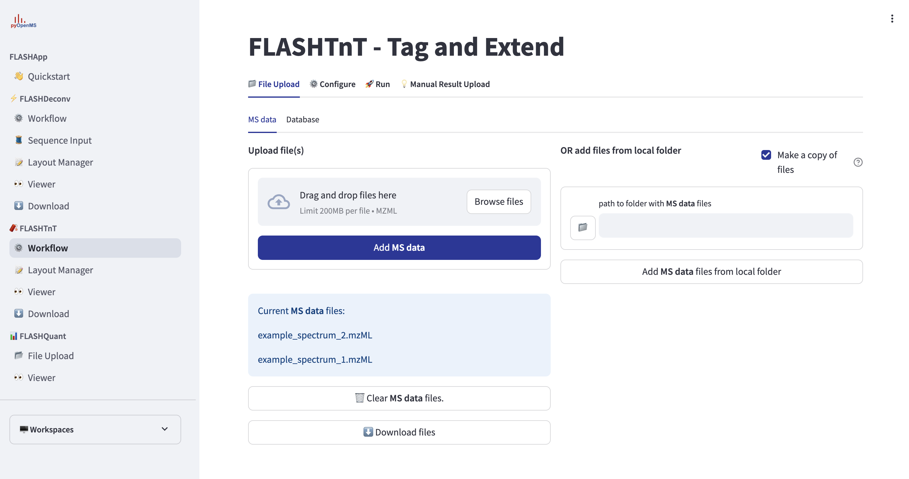

3. Click the **"Database"** tab to upload the protein database (**FASTA** or **PEFF**). FLASHTnT estimates its FDR from decoys: a FASTA file without `DECOY_` entries gets shuffled decoys added automatically, a PEFF file gets its decoys from FLASHTnT.
4. Click **"Add Database"** to confirm the upload.

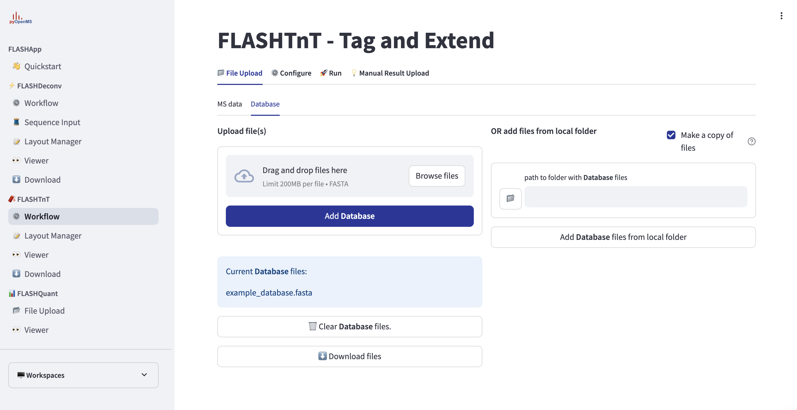
---
## **2️⃣ Configuring Parameters**
1. Navigate to **FLASHTnT > Describe experiment**.
2. Select your uploaded **mzML files**.
3. Choose the **database** file.
4. The tabs follow the steps of the analysis: **1 · Samples and groups** (compare the runs or not, and the condition of each run), **2 · Deconvolution** (FLASHDeconv), **3 · Identification** (FLASHTnT), **4 · Fragment annotation** (FLASHAnnotator) and **5 · Comparison** (how the runs are linked).
5. Adjust FLASHTnT parameters:
Adjust **general settings** such as:
   - **FDR settings** (pro_fdr, protein_fdr) – Proteoform- and protein-level FDR thresholds (e.g., 0.01).
   - **Ion types** (ion_type) – Ion series to consider (e.g., b, y; c, z for ETD/ECD). FLASHAnnotator uses the same ion types.
   - **Modifications** (var_mod, fixed_mod, max_blind_mod_count) – Variable, fixed and blind (unknown) modifications.
   - **Native mode** (native) – For native and targeted top-down data (one or a few spectra, often several proteins per spectrum).
6. FLASHAnnotator annotates each reported proteoform on its raw MS2 spectrum (fragment isotope envelopes at every charge, including internal fragments) and scores it. Its fragment envelopes are the fragment ions shown in the Sequence View.

   
5. Click **Save** to apply settings.

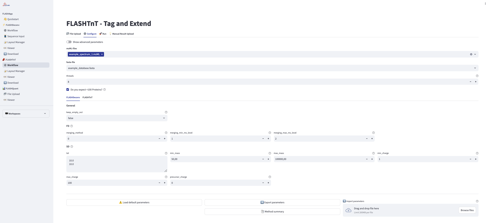
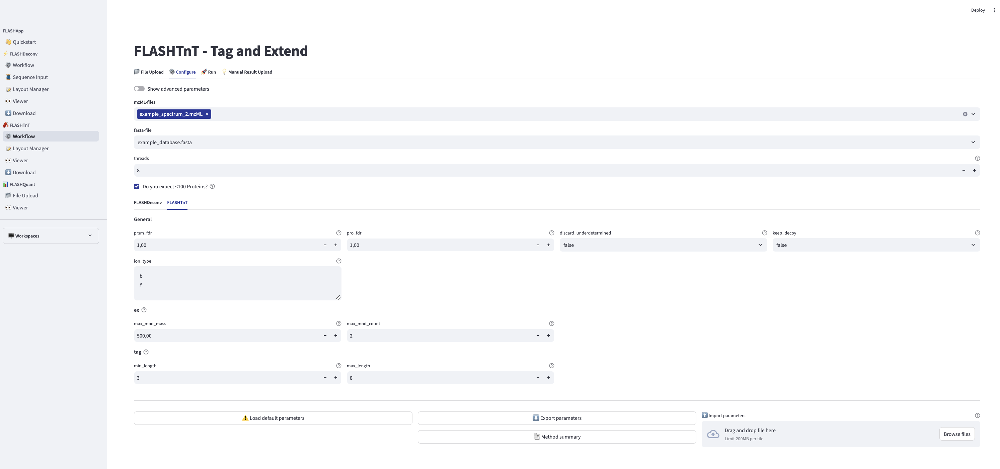

---

## **3️⃣ Running the Workflow**

1. Navigate to **FLASHTnT > Run analysis**.
2. Click **"Start Workflow"** to begin.
3. Monitor the progress in the log output.

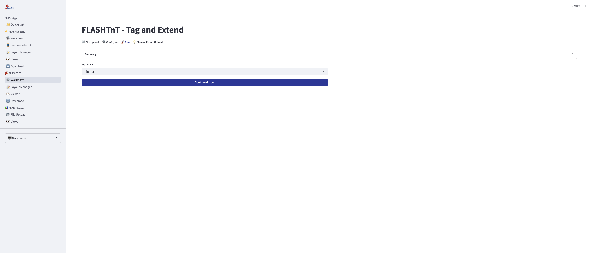

---

## **4️⃣ Layout Manager**

1. On the **Viewer** page, press **Edit layout**.
2. Select how many experiments to display simultaneously (e.g., 1–5).
3. Choose **components** to add for each experiment (search the list, or expand its groups):
- **Protein Table** – Lists proteins identified by FLASHTnT, including accession, modifications, and score. The **Characterization** badge tells how completely the fragments pin down each proteoform: *Characterized* (green) when both termini are determined, every mass shift is localized to one residue and at least 25% of the bonds are explained by fragments; *Ambiguous* (red) below 10%; *Partial* (amber) in between. **Cleavages (%)** and **Localized Mods** give the numbers behind it.
- **Sequence View** – Annotates tags, PTMs, and fragments. Visualizes FLASHTnT results; for FLASHDeconv data must be user-supplied. For FLASHTnT the fragment ions are FLASHAnnotator's raw-spectrum annotation: terminal fragments are marked on the residues, internal fragments as a purple depth strip and brackets on the residues and as an internal fragment track below the sequence (one bar per piece, packed into lanes, colored by ion type, shaded by intensity). Click a bar or residue to select the fragment in the table and highlight its residues.
- **Structure View (3D)** – Part of the default layout. Shows the 3D structure of the selected protein, with the fragmentation points marked in the Sequence View's colors: one residue per terminal ion, where it ends (a/x green, b/y blue, c/z red), and, when FLASHAnnotator reports internal ions, both cleavage sites of each (purple). Modified residues carry the Sequence View's dotted pattern, and termini cleaved off the proteoform are not shown. For proteins with a UniProt accession the AlphaFold DB model is downloaded once and kept in the workspace. The upload button in the viewer stores a PDB or mmCIF file for the selected protein in the workspace too and shows it instead (needed offline and for proteins without a UniProt accession); the delete button goes back to the stored AlphaFold DB model. The database sequence is aligned to the structure, so experimental structures with their own residue numbering work too. Clicking a residue selects it in the Sequence View and Tag Table, and the other way round. Selecting a fragment in the Sequence View (table row, residue or internal fragment bar) colours the residues it covers, labels where it was cleaved (one residue for a terminal ion, both ends for an internal ion), fades the rest of the protein and fits the view to the fragment.
- **Internal Fragment Map** – Shows internal fragment ions from the selected scan
- **Tag Table** – Lists sequence tags with corresponding information.
- **Spectrum View** – Shows the annotated spectrum with matched peaks.
- **Fragment Mass Errors** – Optional (add it in the Layout Manager). The mass error (ppm) of every matched fragment of the selected proteoform against its mass, colored by ion type (FLASHAnnotator's envelopes when present, else the fragments matched within the FLASHTnT tolerance). Errors should scatter around zero; a drift or a group of outliers points to a calibration problem or a wrong assignment. Clicking a point selects the residue next to the fragment's bond.
- **Isotope Envelope Fit** – Optional (add it in the Layout Manager). The observed isotope envelope of the precursor (or of the mass selected in a spectrum) mirrored against the averagine envelope.
- **Identification QC** – Optional (add it in the Layout Manager). Proteoform-spectrum matches per minute of retention time (all best hits, and those within 1% q-value when FLASHTnT estimated q-values), and the median fragment mass error of every best hit over retention time, where a trend shows calibration drift.
- **Precursor XIC by Charge** – The precursor mass of the selected proteoform's spectrum traced over the MS1 spectra, one line per charge plus their sum. Empty when the input has no MS1 spectra.

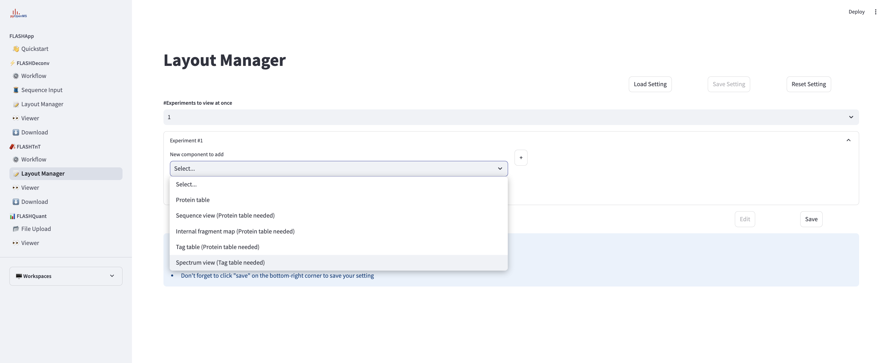

---

## **5️⃣ Viewer**

1. Choose the experiment.
2. View the selected one from Layout manager.

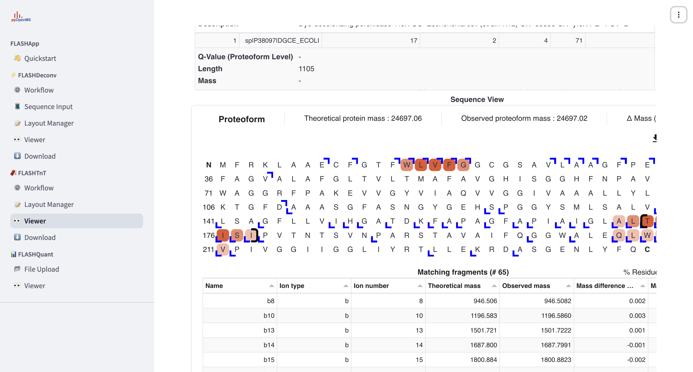

---

## **6️⃣ Manual Result Upload & Example Data**

1. Click **"Manual Result Upload"** to upload manually processed data.
2. Click **"Example Data"** to load a sample dataset.

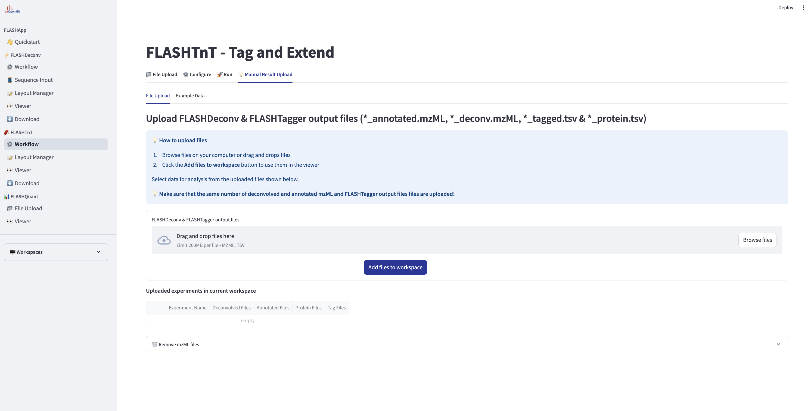

---

## **7️⃣ Downloading Results**

1. Navigate to the **Download** tab.
2. Locate the experiment you want to download.
3. Click **"Prepare Download"** to generate the downloadable files.
4. To delete an experiment, click the **trash icon** next to the experiment name.
 
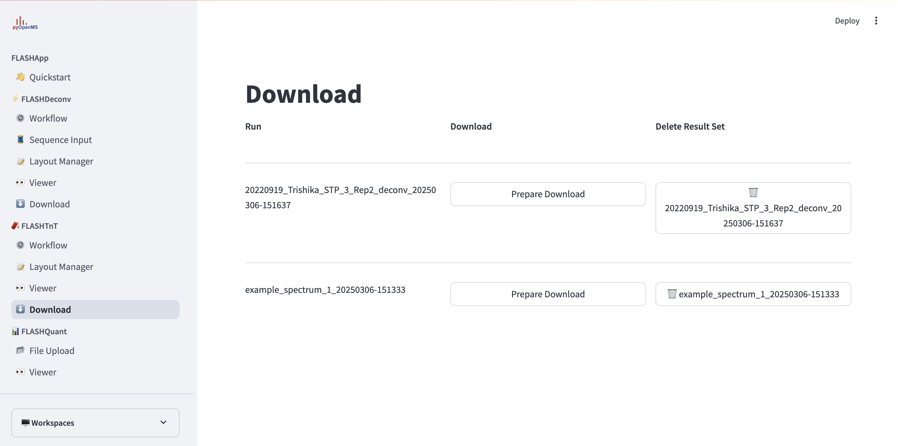

---

# **FLASHQuant Guide**

## **1️⃣ Uploading Results**

Upload FLASHQuant output (`*.fdq.tsv` with its mass traces) on **FLASHQuant > File Upload**, one result per run. The **Viewer** shows the feature groups of one run and their mass traces.

## **2️⃣ Comparing Runs**

**FLASHQuant > Compare Runs** compares the proteoform abundances of several runs.

1. Tick the runs to compare and give each one its **condition** (for example `control` and `treated`). Runs with the same condition are replicates; runs without a condition are linked but not tested.
2. Set the **mass tolerance** (ppm) and **retention time tolerance** (s) for linking, and in how many of a condition's runs a proteoform must be quantified to be tested.
3. Click **Compare runs**. The feature groups of the runs are linked by monoisotopic mass and apex retention time with OpenMS's FeatureLinkerUnlabeledKD algorithm, which also corrects retention time shifts between runs. Abundances are log2 transformed, median normalized, missing values imputed with the smallest value of the proteoform, and compared with a moderated t-test (two conditions) or F-test (more), Benjamini-Hochberg adjusted.

The page then shows:
- **Volcano plot** (two conditions) – log2 fold change against adjusted p-value, with adjustable thresholds.
- **Abundance per run** – the normalized abundance of the selected proteoform in every run, coloured by condition.
- **Linked proteoforms** – every linked proteoform with the number of runs it was found in and its test result.
- **Feature groups per run** – the feature groups linked into the selected proteoform; their index finds them in the Viewer.
- **Clustered heatmap** – z-scores of the 50 most significant proteoforms, with runs and proteoforms clustered.

Clicking a point in the volcano plot or a row in the table selects the proteoform in the other views.

---

## **📖 Need Help?**

If you have any questions or need assistance, feel free to contact our support team.

### **FLASHApp Support Contacts:**
- **Tom Müller**: [tom.mueller@uni-tuebingen.de](mailto:tom.mueller@uni-tuebingen.de)

---

## **📚 Relevant Publications**
For more information about the research behind FLASHDeconv & FLASHTnT, refer to the following publications:

- **Müller, T. D., Kim, J., Almaguer, A., Feroz, A., Kim, J., Walter, A., Jung, W., Kohlbacher, O., & Jeong, K.** (2025).  
  *FLASHApp: Interactive Data Analysis and Visualization for Top-Down Proteomics.*  
  **Proteomics, 25(24), 15-21**  
  📄 [Read the paper](https://doi.org/10.1002/pmic.70042)

- **Jeong, K., Kim, J., Gaikwad, M., Hidayah, S. N., Heikaus, L., Schlüter, H., & Kohlbacher, O.** (2020).  
  *FLASHDeconv: Ultrafast, high-quality feature deconvolution for top-down proteomics.*  
  **Cell Systems, 10(2), 213-218.e6**  
  📄 [Read the paper](https://doi.org/10.1016/j.cels.2020.01.003)

- **Müller, T. D., Siraj, A., Walter, A., Kim, J., Wein, S., von Kleist, J., Feroz, A., Pilz, M., Jeong, K., Sing, J. C., Charkow, J., Röst, H. L., & Sachsenberg, T.** (2024, November 20).  
  *OpenMS webapps: Building user-friendly solutions for MS analysis.*  
  📄 [Read the paper](https://pubs.acs.org/doi/10.1021/acs.jproteome.4c00872)

- **Pfeuffer, J., et al.** (2024).  
  *OpenMS 3 enables reproducible analysis of large-scale mass spectrometry data.*  
  **Nature Methods, 21(3), 365-367**  
  📄 [Read the paper](https://doi.org/10.1038/s41592-024-02197-7)
---

🚀 **You're now ready to use FLASHDeconv & FLASHTnT!**

